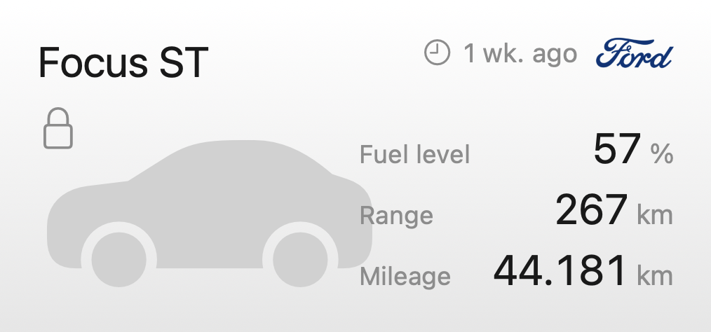
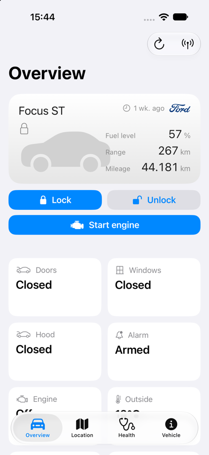
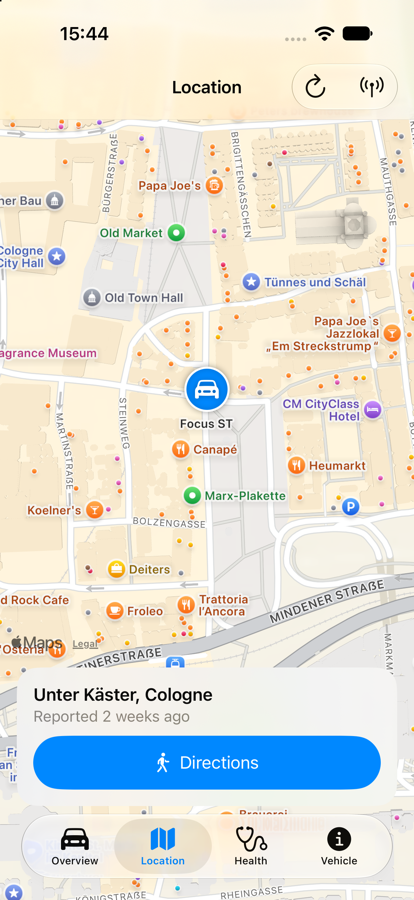
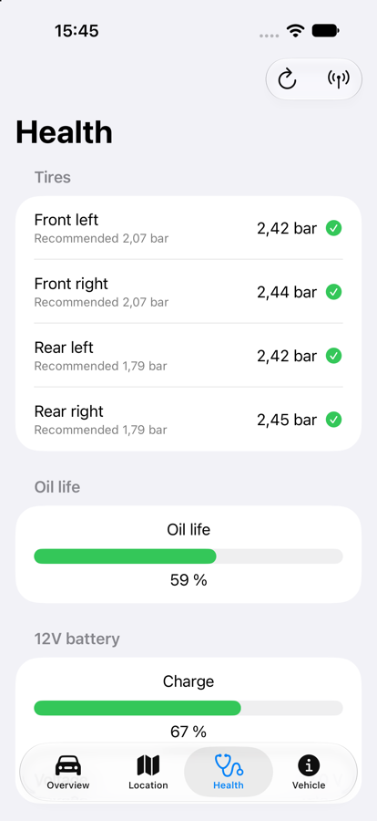
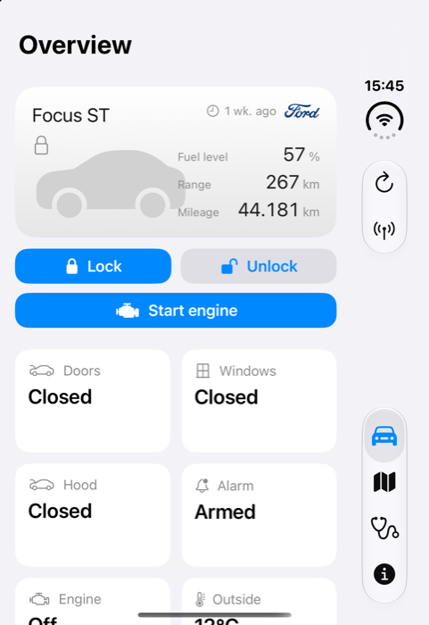
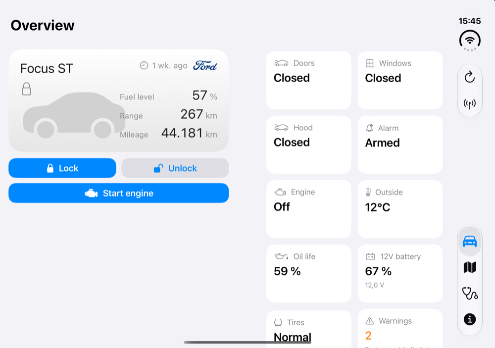

  

<h1 align="center">My Ford</h1>

  Your Ford's fuel, range, lock state and location on your Home Screen, in a native SwiftUI app built for iPhone and iPhone Duo.

  

> [!WARNING]
> This is an unofficial, personal project. It is not affiliated with, endorsed by, or supported by Ford Motor Company. It talks to the same private FordPass and Autonomic endpoints as the official app, and Ford can change or block them at any time.

## What you get

  
  
  

- **Home Screen widget.** A medium widget with the car's name, lock state, last update, fuel level, range and mileage. It refreshes itself about every 30 minutes and falls back to the last saved data when Ford is unreachable.
- **Overview.** The same card, plus Lock, Unlock and Start engine, and tiles for doors, windows, hood, alarm, engine, outside temperature, oil life, the 12V battery, tires and warning lights.
- **Location.** Where the car was last reported, with its street address and walking directions in Apple Maps.
- **Health.** Each tire's pressure next to Ford's recommended value, oil life, 12V charge and voltage, coolant temperature, and active warning lights in plain words.
- **Vehicle.** Model, year, color, plate, a masked VIN, and how fresh the data is.

The app shows only the actions your car's account allows. Unlock and Start engine ask for Face ID, Touch ID or your passcode first. "Update from car" wakes the car's modem, so it asks for confirmation and runs at most once every 15 minutes.

## Built for iPhone Duo

  
  

On the outer display the tab bar moves to the side, as on the system apps. When you open the phone, Overview splits into the card and its controls on one side and the status tiles on the other, with the fold between them. In the half-folded pose, the location card measures where the fold is and stays clear of it, so no button sits on the hinge.

## How it talks to Ford

1. You sign in on Ford's own login page in a Safari sheet. The app never sees your password. It receives a one-time code from Ford's `fordapp://` redirect.
2. The app exchanges that code for Ford tokens and stores them in the Keychain. They are readable only on this device, never in backups.
3. For car data, the app trades the Ford refresh token for an Autonomic token. It reads telemetry from Autonomic's websocket and falls back to a plain request.
4. A command (lock, unlock, start) is sent once per tap. The app then polls the car's state for that command's id until the car confirms, fails or stays silent.

Only the app writes the login. The widget reads it, fetches on its own and saves its own snapshot file, so the two never overwrite each other's data.

The endpoint knowledge comes from the open-source Home Assistant integration [marq24/ha-fordpass](https://github.com/marq24/ha-fordpass). Thanks to its contributors.

## Get started

You need Xcode 27.2 or later, [XcodeGen](https://github.com/yonaskolb/XcodeGen) and an Apple Developer team. The app runs on iOS 27.1 or later.

1. Clone the repo and open `project.yml`.
2. Set `DEVELOPMENT_TEAM` to your team ID and `BUNDLE_ID_PREFIX` to a bundle ID you own. The App Group becomes `group.<prefix>` automatically.
3. Generate the project with `xcodegen generate`.
4. Open `FordWidget.xcodeproj`, select your iPhone and run the `FordWidget` scheme.
5. In the app, choose your country and tap **Sign in with Ford**.
6. Long-press the Home Screen, tap **Edit**, then **Add Widget**, and add **My Ford**.

## Check your changes

Every check is a script you can run again. None of them contacts Ford.

| Script | What it proves |
| - | - |
| `scripts/check-parser.sh` | Telemetry, garage, command-state and wire-format parsing against recorded responses in `Fixtures/` (188 assertions). |
| `scripts/build.sh` | Simulator and device builds, plus checks that the widget is embedded and configured and that the Face ID usage text exists. |
| `scripts/render-card.sh` | Renders the widget card to `build/card.png` on macOS. |
| `scripts/parity.sh` | Compares the card with a screenshot of the original widget and prints the pixel difference. |
| `scripts/screens.sh` | Screenshots every tab on iPhone 18 Pro and on each iPhone Duo pose, from demo data. On iPhone it also captures the end of Overview and Health (`*-bottom.png`), where the warnings are. See `docs/checks/warnings/`. The Duo poses need a `duo` helper that presses Device Hub's fold buttons, which needs Accessibility permission. Set `DUO` to its path. Without it, the script skips the Duo. |
| `scripts/make-icon.swift` | Draws the app icon and its dark and tinted variants. |

The fixtures come from a real car with the VIN, location, plate and all ids replaced.

## Project layout

- `Shared/` holds code used by the app and the widget: the Ford API client, the parser, storage and the vehicle card view. It compiles on macOS too, which the scripts rely on.
- `App/` holds the app's screens, the command flow and the sign-in sheet.
- `Widget/` holds the WidgetKit extension.
- `Fixtures/` holds the sanitized responses the parser checks run against.
