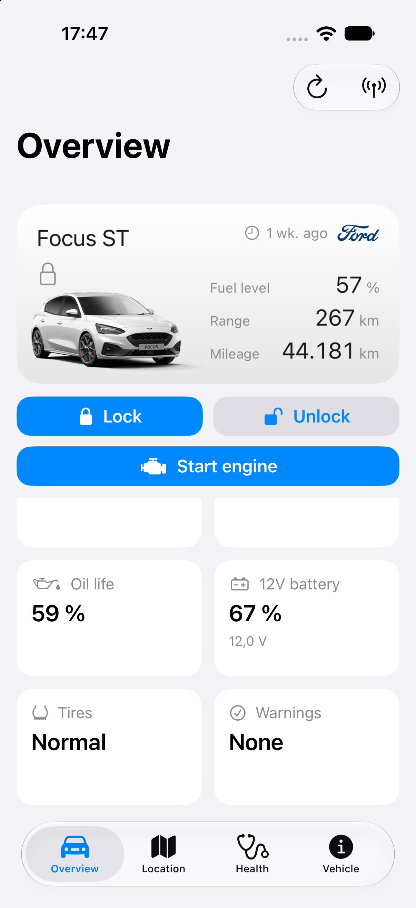
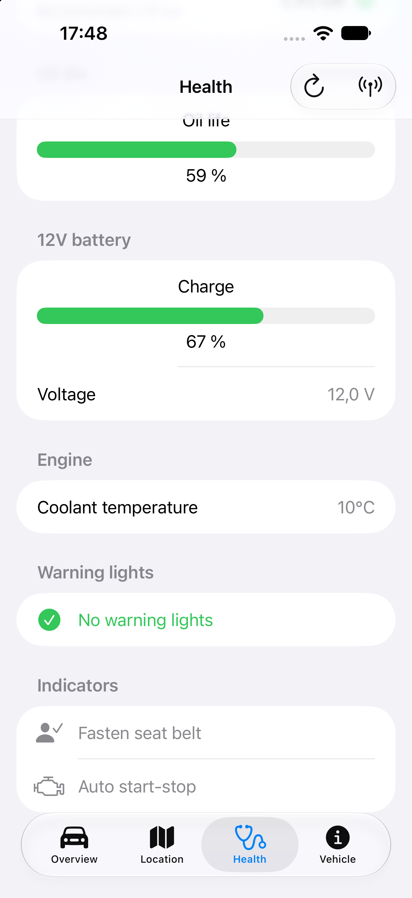

# Warnings vs. indicators

Lights that only report normal operation (fasten seat belt, auto start-stop, traction control active, glow plugs heating) are not counted as warnings. The list is `informational` in `App/WarningNames.swift`. Unknown lights still count as warnings.

Re-run:

```sh
SCREENS_ONLY=phone SCREENS_TABS="overview health" ./scripts/screens.sh
```

It uses `Fixtures/telemetry-full.json`, where only seat belt and start-stop are lit. Expected result:

- `build/screens/iphone18pro-overview-bottom.png`: the Warnings tile reads "None" with a checkmark, not an orange count.
- `build/screens/iphone18pro-health-bottom.png`: "No warning lights", then an "Indicators" section listing both lights in grey.

The captures below come from 2026-11-17.

 
